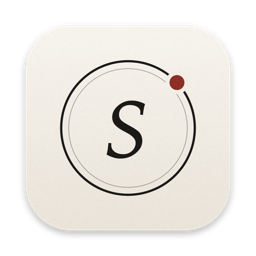
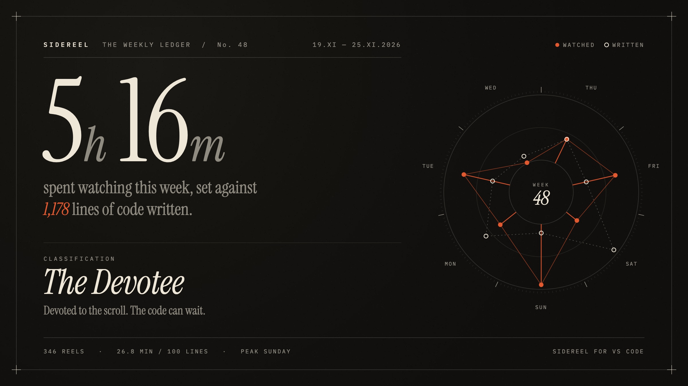

<p align="center">
  
</p>

<h1 align="center">Sidereel</h1>

<p align="center">
  A short-video window that floats beside your editor.<br>
  A boss key for when someone walks by.<br>
  And a weekly ledger of what it cost you.
</p>

<p align="center">
  
</p>

## What it does

- **A sidecar window.** Opens your short-video feed (Instagram Reels by default, or any URL such as YouTube Shorts) in a phone-sized window pinned to the right edge of your screen, above everything, including full-screen VS Code.
- **One flick, one video.** A trackpad swipe or mouse-wheel flick moves exactly one video. `↓` / `j` and `↑` / `k` work too.
- **Boss key.** `Ctrl+Cmd+B` (macOS) / `Ctrl+Shift+Alt+B` (Windows, Linux) pauses the video and hides the window instantly. Press it again to bring it back without stealing focus.
- **The Weekly Ledger.** The status bar keeps a quiet tally of time watched against lines written. Click it for a shareable card: your week as a star chart, and a classification from *The Ascetic* to *The Devotee*. Save it as a 2400×1350 PNG or post it straight to X.

## Install

Search **Sidereel** in the Extensions view of VS Code, Cursor, or Windsurf, or:

```sh
code --install-extension Devxsh03eth.sidereel
```

Then press `Cmd+Alt+R` (macOS) / `Ctrl+Alt+R` (Windows, Linux), or click **▶ Sidereel** in the status bar. Sign in to the site once; the session is remembered.

## Commands

| Command | macOS | Windows / Linux |
|---|---|---|
| Sidereel: Toggle | `Cmd+Alt+R` | `Ctrl+Alt+R` |
| Sidereel: Boss Key | `Ctrl+Cmd+B` | `Ctrl+Shift+Alt+B` |
| Sidereel: Weekly Ledger | click the status bar tally | click the status bar tally |

## Settings

| Setting | Default | |
|---|---|---|
| `sidereel.url` | `https://www.instagram.com/reels/` | Any short-video URL, e.g. `https://www.youtube.com/shorts/` |
| `sidereel.width` / `height` | `420` / `860` | Window size |
| `sidereel.x` / `y` | `-1` / `60` | Position; `x = -1` means the right edge |
| `sidereel.alwaysOnTop` | `true` | macOS: native floating window. Off = browser window |
| `sidereel.mobileLayout` | `false` | Ask the site for its phone layout |
| `sidereel.browserPath` | auto | Edge/Chrome to use for the browser window |

## Platforms

| | macOS 12+ | Windows | Linux |
|---|---|---|---|
| Window | Native floating window (Apple Silicon and Intel) | Edge or Chrome app window | Chrome, Edge or Chromium app window |
| Always on top | Yes | Yes | No |
| Boss key | Pause and hide | Pause and hide | Closes the window |
| Watch time, one-flick scrolling | Yes | Yes | Yes |
| Weekly Ledger | Yes | Yes | Yes |

Sidereel runs on your local machine even when you are connected to a remote (SSH, WSL, containers).

## Privacy

- Everything stays on your computer. The tally of minutes watched and lines written lives in VS Code's local extension storage. Nothing is sent anywhere, and there is no telemetry.
- Sidereel never reads your code. It only counts new lines as you type.
- Your sign-in lives in a separate profile used only by Sidereel (`~/.sidereel-profile-*` for the browser window, or the native app's own storage on macOS). Your everyday browser is untouched.

## Security note (Windows, Linux, and macOS browser mode)

To pause videos and measure watch time, Sidereel opens its browser window with the DevTools protocol enabled on a random local port. While the window is open, other programs on your computer could connect to that port and act inside Sidereel's browser profile. It cannot reach your normal browser. Close the window when you're done if this matters to you. The macOS native window does not use DevTools.

## Disclaimer

Sidereel is an independent project. It is not affiliated with, endorsed by, or sponsored by Instagram, Meta, YouTube, or Google. It simply opens the website you choose in a window, and you use that site under its own terms.

## Build from source

```sh
git clone https://github.com/thinkfi03/sidereel && cd sidereel
./native/build.sh            # macOS app (needs Xcode Command Line Tools)
npx @vscode/vsce package     # produces sidereel-<version>.vsix
code --install-extension sidereel-*.vsix
```

## License

[MIT](LICENSE)
